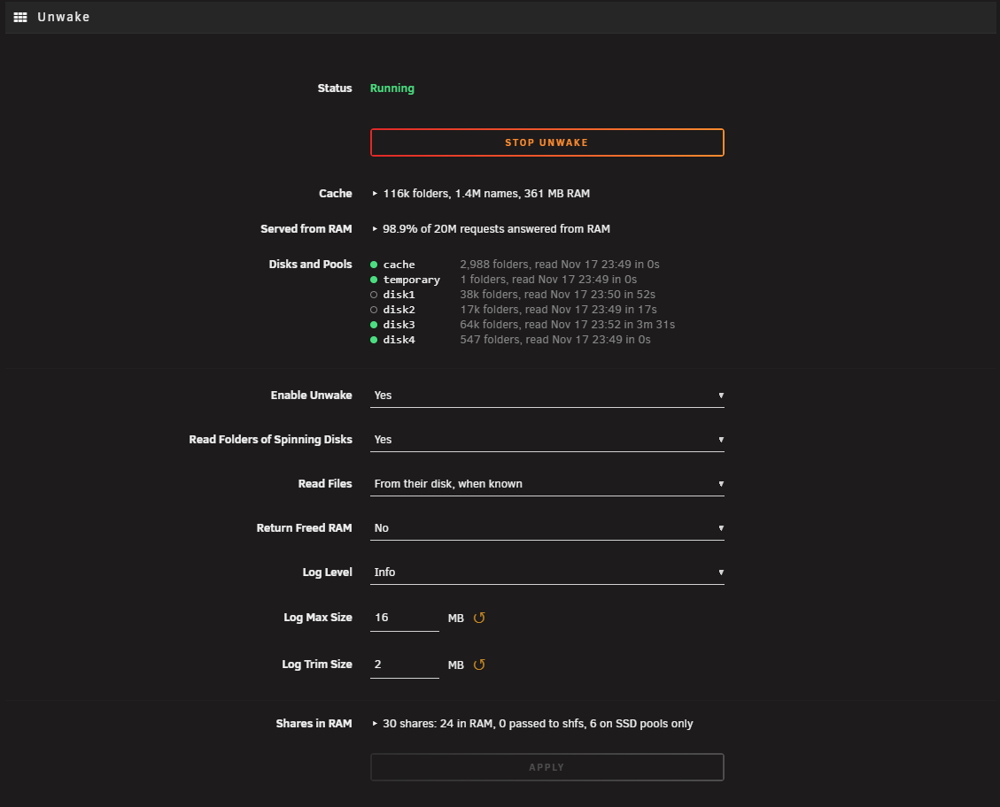
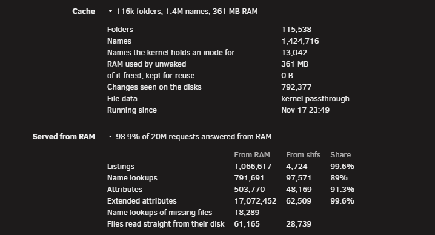
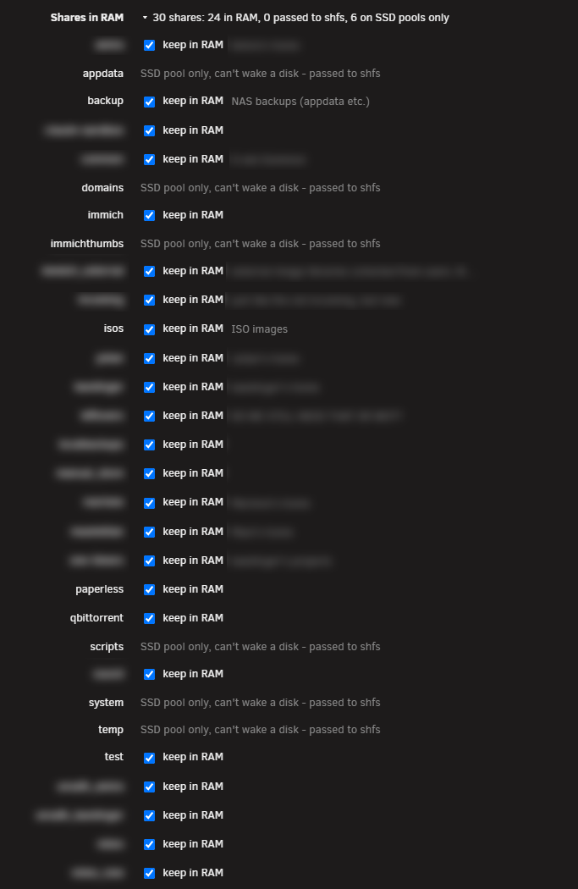
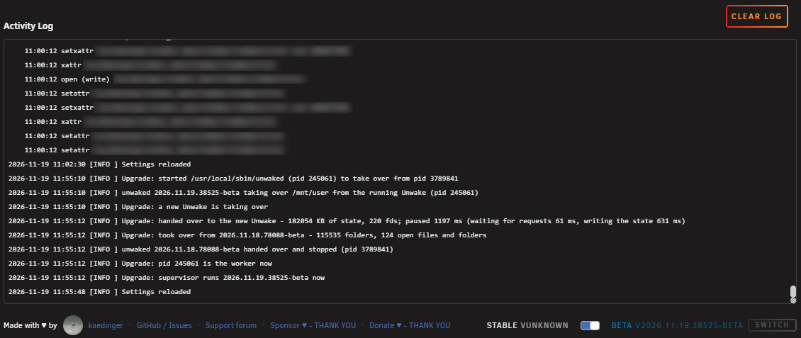

# Unwake - Directory Caching for Unraid User Shares

Keeps every folder of the user shares in RAM, so browsing them doesn't wake sleeping disks. Not for a while after the last browse, not until a backup pushes the kernel's caches out - for good, kept current as files change. The main goal is fewer disk spin-ups; faster folder listings come for free.

Unwake's brother is [Unspin](https://github.com/kaedinger/unspin), which has the same goal for file data: it moves the most-used files to faster storage, so reading them doesn't wake disks either. Unwake keeps browsing from waking disks, Unspin keeps reading from doing so; they work well together.

<p align="center">
  
</p>

<p align="center">
  <a href="https://github.com/kaedinger/unwake/releases/latest"></a>
  <a href="https://github.com/kaedinger/unwake/releases"></a>
  <a href="https://github.com/kaedinger/unwake/releases"></a>
  <a href="https://github.com/kaedinger/unwake/releases"></a>
  <br>
  <a href="https://unraid.net/"></a>
  <a href="https://github.com/kaedinger/unwake/issues"></a>
  <a href="https://forums.unraid.net/topic/201382-plugin-unwake-directory-caching-for-unraid-user-shares/"></a>
</p>

---

## How It Works

Unraid's user shares (`/mnt/user`) are served by `shfs`, which merges the folders of all array disks and pools into one tree. To list a folder, shfs asks every disk that may hold a part of it. If that disk's folder isn't in the kernel's caches any more, the disk spins up - for a folder listing, a file name that doesn't exist (Windows asks for `desktop.ini` and `Thumbs.db` everywhere), or the File Manager asking where a share lives. Dynamix Cache Directories fights this by re-reading every folder over and over, so the kernel keeps them; a backup or a big copy still pushes them out, and the re-reading itself keeps disks busy.

Unwake runs `unwaked`, a FUSE daemon that sits **on top of** `/mnt/user` - shfs stays mounted underneath - and answers from its own tree in RAM:

| Request | Answered from |
|---|---|
| Folder listing (`ls`, SMB, NFS, File Manager) | RAM |
| Name lookup, including names that don't exist | RAM |
| File attributes (size, times, owner, mode) | RAM |
| Extended attributes (Samba's `user.DOSATTRIB`, ...) and `system.LOCATION(S)` | RAM |
| Reading and writing file data | the disk, as before (see *File data* below) |
| Creating, renaming, deleting | shfs, as before |

**Filling the tree.** Unwake reads a disk's folders only while that disk spins anyway, at idle I/O priority, and never wakes a disk to do so. A disk that sleeps when Unwake starts is read the next time something else spins it up. Until then, its folders are passed to shfs, as without Unwake.

**Keeping it current.** Unwake watches every disk and pool with **fanotify**, one mark per file system. Every change - through Unwake, straight on `/mnt/diskN`, by the Mover, Unbalanced, a container or Unspin - updates the tree right away. Unwake doesn't re-read folders to find changes; only the verifier (below) checks the tree against the disks, slowly and only while a disk spins anyway.

**What stays out of RAM.** Shares that live on an SSD pool only can't wake a disk, so they aren't kept in RAM; Unwake sends their requests straight to that pool, not through shfs, which would look every path up on every disk. If an array disk still holds folders of such a share, it's kept in RAM like the others. Any share can be unticked to pass it to shfs.

### Verifier

A safety net for the tree: should it ever differ from a disk (a missed event, a bug), the verifier finds and repairs it. By default once a day per disk, it compares the folders in RAM with that disk, at most 50 folders per second, and only while the disk spins and something else uses it, so it never wakes a disk or keeps one awake. It starts on a disk once that disk's folders were read the first time, so it needs `HARVEST=yes`. A difference counts only if a second look a little later shows the same; it's repaired in RAM and written to `/var/log/unwake-verify.log`. Betas always verify and show its progress on the settings page; stable releases verify without showing it. Rate, interval and switch: `VERIFY_*` below.

### File data and kernel passthrough

Unwake isn't in the way of file data: with Linux 6.9+ (Unraid 7.2 has 6.12, 7.3.2 has 6.18), it hands every opened file to the kernel (**FUSE passthrough**), which then reads and writes it directly - no copy through the daemon, no extra page cache. A file that lives on exactly one known disk is opened on that disk, skipping shfs (*File data: direct*).

The kernel takes **one backing file per file**, shared by everything that has the file open. Unwake therefore opens that backing file **for reading and writing**, even when the first program only reads it - otherwise a program that wants to write the file while another one reads it (qBittorrent finishing a download that Plex is scanning, Word saving a document that Explorer's preview holds open) would be refused. What that means:

- While a file is open through `/mnt/user`, Unwake holds it open for writing. That changes nothing on the disk, but a program that tries to *execute* that same file via `/mnt/diskN` or `/mnt/cache` at that moment gets "text file busy".
- Tools that count file opens on the disks (Unspin) see one extra open when a file is first opened.
- Files that **smbd (SMB) or nfsd** open for reading are the exception: Unwake reads them for the server itself. Those servers send file data with `sendfile`, and a sendfile through passthrough reads the disk without telling tools that watch the disks - Unspin wouldn't count the reads of a movie played over SMB. The cost is what shfs cost before Unwake: the data passes through a daemon.
- Where a read-write open isn't possible (read-only file system, a file being executed), the backing is read-only; a program opening that file for writing while it's open elsewhere gets "device or resource busy".

### Updates without restarting anything

A plugin update switches Unwake in place: the running version hands its FUSE connection, its tree, and every open file and folder to the new one. The mount on `/mnt/user` stays the same, so containers, VMs, SMB clients and shells carry on without a restart; they see a pause of about a second. If the new version can't take over, the old one simply keeps running.

---

### RAM after a backup

Besides the tree, Unwake keeps an entry (about 200 bytes) for every name the kernel currently holds an inode for. A backup or media scan through `/mnt/user` touches nearly every name, so during the night that's most of them. The kernel lets go of them later, or when it needs the memory, and Unwake frees those entries.

What happens to that freed memory is up to *Return Freed RAM*:

- **Yes** (default): Unwake hands it back to the system a few minutes later. Some of it stays: a page of memory where a few entries are still in use can't be given back.
- **No**: Unwake keeps it for the next backup, which then doesn't have to get it from the system again. That saves a few milliseconds a night, but Unwake holds the night's peak all day. The settings page shows how much of its RAM is such kept memory.

Measured on the author's server (1.4 million names): 376 MB before the nightly backup, 864 MB the next morning with *No*, 479 MB seconds after switching to *Yes*.

## Features

- **Folders in RAM, for good** - listings, lookups (including of names that don't exist), attributes and extended attributes answered without touching shfs; nothing pushes them out of memory
- **Never wakes a disk to read it** - folders are read while a disk spins anyway, at idle I/O priority
- **Event-driven** - fanotify on every disk and pool keeps the tree current, whoever changes a file; no polling. A slow daily verifier, only while disks spin anyway, catches anything missed
- **All Unraid file systems** - XFS, btrfs, ZFS (datasets are followed as they come and go), on array disks and pools
- **Stacked, not replacing** - shfs stays mounted underneath; stopping Unwake takes it off at once, and what still uses it keeps working until it lets go
- **Kernel passthrough for file data** - no copy through the daemon; files on one known disk are read from that disk directly
- **In-place updates** - same mount, same open files; containers and VMs don't notice
- **Shares in RAM** - every share listed with a tick box; SSD-pool-only shares are detected and go straight to their pool, unless an array disk still holds parts of them
- **Spin-up diagnostics** - when a disk spins up, the log lists what Unwake passed to shfs that could have reached that disk
- **Safe by design** - if `unwaked` dies, the supervisor takes its mount away at once, so `/mnt/user` is plain shfs again, and restarts it; on array stop, Unwake gets out of the way within 10 seconds
- **Diagnostics in one file** - `rc.unwake diag`, and `rc.unwake users` names whatever still uses an older instance
- **Live log viewer** - repeated entries folded

---

## Installation

### Via Community Applications (recommended)

1. Install the **Community Applications** plugin
2. Search for **Unwake**
3. Click Install

### Manual

```bash
plugin install https://github.com/kaedinger/unwake/releases/latest/download/unwake.plg
```

Settings under *Settings → Utilities → Unwake*.

Unwake replaces Dynamix Cache Directories: turn that off under *Settings → Folder Caching*. If it left `vfs_cache_pressure` at a low value, the settings page offers to set it back to 100.

### Stable and beta channel

New features come out as betas first. The switch at the bottom right of the settings page shows the newest version on each channel and switches between them; from then on, the Plugins page offers updates from that channel. Every stable fix reaches the beta channel too. Settings stay across a switch; going back to stable drops those that only exist in the beta.

On the beta channel, Community Applications doesn't list Unwake under *Installed Apps*, and Fix Common Problems warns that it's *not known to Community Applications*: CA only knows the stable version. Both are harmless; manage Unwake on the Plugins page.

To install the beta directly:

```bash
plugin install https://raw.githubusercontent.com/kaedinger/unwake/channel/unwake.plg
```

---

## Configuration Reference

| Key | Default | Description |
|---|---|---|
| `SERVICE` | `disabled` | `enabled` puts Unwake on top of `/mnt/user` when the array starts |
| `HARVEST` | `yes` | Read the folders of disks while they spin anyway. `no`: only folders listed through Unwake are kept |
| `DATA_PATH` | `direct` | `direct`: a file on exactly one known disk is opened on that disk; `shfs`: all files through shfs |
| `RETURN_RAM` | `yes` | Once the kernel has let go of many names (a backup's, hours later), hand the freed RAM back to the system. `no`: keep it for the next backup (see *RAM after a backup*) |
| `EXCLUDED_SHARES` | *(empty)* | Shares passed to shfs, never kept in RAM. Managed by *Shares in RAM* on the settings page |
| `INCLUDED_SHARES` *(hidden)* | *(empty)* | SSD-pool-only shares kept in RAM anyway |
| `LOG_LEVEL` | `info` | `info` or `debug` |
| `LOG_MAX_SIZE_MB` | `16` | The log is cut once it grows past this |
| `LOG_TRIM_SIZE_MB` | `2` | How much of the newest log is kept when it's cut |
| `VERIFY` *(hidden)* | `yes` | Run the verifier (see *Verifier*). `no` turns it off; a beta always verifies |
| `VERIFY_RATE` *(hidden)* | `50` | Folders per second and disk the verifier checks (at least `1`) |
| `VERIFY_INTERVAL` *(hidden)* | `86400` | Seconds from the end of a disk's pass to its next one (`0`: right away) |
| `COMPANION_LABEL` *(hidden)* | `yes` | Show the name next to Unspin's icon in the pill at the top right of the settings page (`yes`), or the icon only (`no`) |
| `COMPANION_HINT` *(hidden)* | `yes` | While Unspin isn't installed, the pill says that Unwake works best with Unspin and links to it (`yes`); `no` hides the pill instead |

*Hidden* settings aren't on the settings page. Set them in `/boot/config/plugins/unwake/unwake.cfg` (for example `VERIFY_RATE="20"`), then run `/etc/rc.d/rc.unwake reload`. Saving the settings page keeps them.

---

## Service Control

```bash
/etc/rc.d/rc.unwake start
/etc/rc.d/rc.unwake stop              # take it off /mnt/user; what still uses it keeps working until it lets go
/etc/rc.d/rc.unwake stop --array      # same, but cut off after 10 s (array stop)
/etc/rc.d/rc.unwake restart           # switch in place when possible, else stop and start
/etc/rc.d/rc.unwake restart --fresh   # always stop and start
/etc/rc.d/rc.unwake upgrade           # switch to the installed binary in place (the plugin does this after an update)
/etc/rc.d/rc.unwake status
/etc/rc.d/rc.unwake reload            # re-read the settings
/etc/rc.d/rc.unwake users             # who still uses an older, detached instance
/etc/rc.d/rc.unwake diag              # everything for a problem report, in one file under /tmp
```

---

## Daemon CLI

```bash
# Normal run (reads /boot/config/plugins/unwake/unwake.cfg, mounts on /mnt/user)
/usr/local/sbin/unwaked

/usr/local/sbin/unwaked --version
/usr/local/sbin/unwaked --config /path/to/unwake.cfg --log /path/to/unwake.log
/usr/local/sbin/unwaked --no-supervisor          # the worker only, without the watchdog
/usr/local/sbin/unwaked --bench-handover 1400000 # time an in-place update with a tree of that many names
```

---

## Screenshots

Status and settings:



Cache details and requests served from RAM:



Shares in RAM:



Activity log, an in-place update, stable and beta channel:



---

## Requirements

- Unraid 7.2.0 or newer (tested with 7.3.2)
- RAM: about 270 bytes per file and folder name for the tree (1.4 million names: about 380 MB), more during and after a backup - see *RAM after a backup*
- Linux 6.9+ for kernel passthrough (without it, file data goes through the daemon)
- No external dependencies

---

## Building

`make build-daemon package` (needs meson and ninja for libfuse, which is patched and linked statically). Releases are built by CI from tags `YYYY.MM.DD.SECS` (stable, on `main`) and `YYYY.MM.DD.SECS-beta` (on `beta`). CI runs `tests/integration.sh` on every push: real FUSE mounts on loop-device XFS disks, with mergerfs standing in for shfs.

### Checking a release

Every release's package and `unwaked` carry a build provenance attestation, signed by GitHub: it says which workflow run built them, from which commit. To check a downloaded package (needs the GitHub CLI):

```bash
gh attestation verify unwake-VERSION-x86_64-1.txz --repo kaedinger/unwake
```

The commit it names is the source to read. Stable releases ship `unwaked` stripped and without test hooks (`TEST_HOOKS=0`); their debug info is the release asset `unwaked-VERSION.debug`, for resolving a crash backtrace from the log. Betas keep the debug info and the test hooks in the binary.

---

## License

GPLv2. Contributions welcome - open an issue or PR on GitHub.

## History

Unwake came out of [Unspin](https://github.com/kaedinger/unspin)'s disk wake-up tracking: once it showed *who* woke the disks, most of the wake-ups turned out to be folder listings and name lookups that Dynamix Cache Directories couldn't keep in memory. Unwake was designed and written with Claude Code, and tested on the author's own server.
